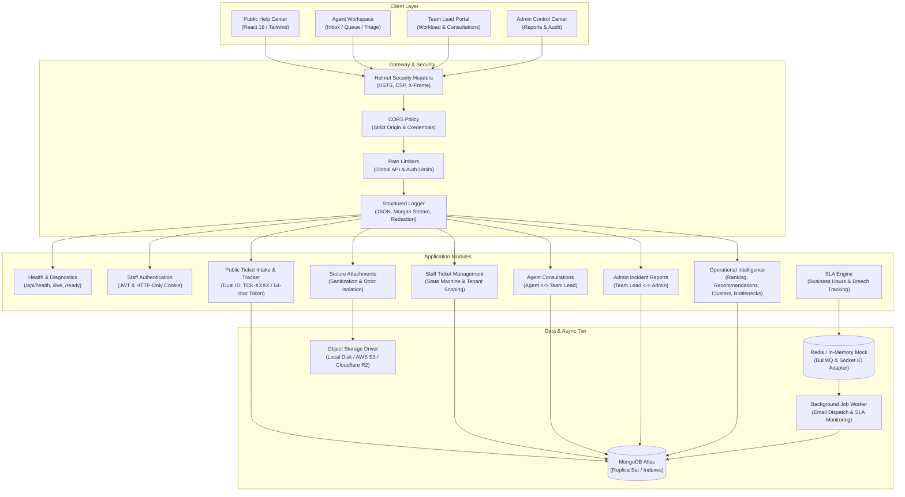

# SupportFlow — Customer Support Operations Platform

SupportFlow is an explainable, multi-tenant customer support operations platform designed for small-to-midsize SaaS teams. It streamlines the complete support lifecycle from unauthenticated public ticket intake and dual-identifier tracking to staff triage, SLA compliance, role-based collaboration, and explainable operational intelligence.

---

## Architecture Overview

SupportFlow uses a **Modular Monolith** architecture with strict layering, multi-tenant workspace isolation, and asynchronous event queues.



### Architectural Principles

1. **Multi-Tenant Isolation**: Every staff-accessible query unconditionally enforces `workspaceId: req.user.workspaceId`. Client-supplied IDs are never trusted without verified workspace membership.
2. **Customer vs. Staff Visibility**: Customers track tickets using either a friendly ID (`TCK-1008`) or a 64-character cryptographic token (`/track/:token`). Internal notes, staff assignments, and internal consultations are strictly excluded from public responses.
3. **Attachment Access Restrictions**: Public tracking routes strictly reject requests for internal attachments (HTTP 403). Cross-workspace access by staff is blocked (HTTP 404). File uploads enforce extension blacklists (`.exe`, `.sh`, `.bat`), 10MB limits, and directory traversal sanitization.
4. **Resilient Background Processing**: Queue operations (SLA checks, email dispatches) use BullMQ with 3 retry attempts, exponential backoff, job deduplication keys, and an automatic in-memory fallback when external Redis is offline.
5. **Explainable Operations (No Black-Box ML)**: Queue prioritization and agent assignment recommendations expose clear mathematical factors, weights, and explanation strings. Text similarity clustering uses structured categories and normalized Jaccard word analysis, explicitly flagged as potential incidents requiring human review.

---

## Tech Stack

| Layer | Technology | Rationale |
| :--- | :--- | :--- |
| **Frontend** | React 18, TypeScript, Vite, Tailwind CSS | Fast SPA rendering, typed API consumption, reactive state |
| **Data Fetching** | TanStack React Query v5 | Automatic background refetching, cache invalidation, and optimistic mutations |
| **Real-time** | Socket.IO Client & Server | Sub-second ticket updates, message notifications, and consultation pings |
| **Backend API** | Node.js, Express, TypeScript | Modular monolith with typed controllers, services, and middlewares |
| **Database** | MongoDB Atlas, Mongoose 8 | Document schema with compound tenant indexes and atomic transitions |
| **Validation** | Zod (v3) | Strict runtime schema parsing for request bodies and environment variables |
| **Background Jobs**| BullMQ & Redis | Reliable distributed job queue with exponential backoff and deduplication |
| **Security** | Helmet, bcryptjs, jsonwebtoken, express-rate-limit | Hardened HTTP headers, password hashing, and brute-force mitigation |
| **Observability** | Winston-inspired Structured Logger, Morgan | JSON production logs, secret credential redaction, Morgan stream integration |
| **Unit & API Tests**| Vitest, Supertest, mongodb-memory-server | Blazing fast integration test execution with isolated in-memory MongoDB |
| **E2E Testing** | Playwright Test | Browser-level end-to-end test execution (Chrome/Edge channels) |

---

## Environment Variable Reference

Ensure secrets are never committed to version control. The repository includes `.env.example` templates.

### Backend (`backend/.env`)

| Variable | Type | Default | Description |
| :--- | :--- | :--- | :--- |
| `PORT` | Number | `5000` | Port for the Express API server |
| `NODE_ENV` | String | `development` | Environment mode (`development`, `production`, `test`) |
| `MONGODB_URI` | String | *Required* | MongoDB connection string (Atlas URI or local `mongodb://...`) |
| `CLIENT_URL` | String | `http://localhost:5173` | Allowed origin for CORS headers |
| `JWT_SECRET` | String | *Required* | Minimum 32-character secret key for signing short-lived access tokens (enforced in production) |
| `JWT_ACCESS_EXPIRES_IN` | String | `15m` | Lifespan of short-lived access tokens delivered via HTTP-only cookie |
| `JWT_REFRESH_SECRET` | String | *Required* | Minimum 32-character secret key for signing long-lived refresh tokens (enforced in production) |
| `JWT_REFRESH_EXPIRES_IN` | String | `7d` | Lifespan of rotating refresh tokens stored hashed in DB and delivered via HTTP-only cookie |
| `REDIS_URL` | String | `redis://localhost:6379` | Redis connection URI (falls back safely to in-memory mock if unreachable) |
| `LOG_LEVEL` | String | `info` | Logging verbosity (`debug`, `info`, `warn`, `error`) |
| `STORAGE_DRIVER` | String | `local` | Attachment storage provider (`local` or `s3`) |
| `STORAGE_LOCAL_PATH` | String | `./uploads` | Directory for storing uploaded files when using local driver |
| `S3_ENDPOINT` | String | — | S3-compatible API endpoint (MinIO, Cloudflare R2, AWS S3) |
| `S3_BUCKET` | String | — | Target bucket name for attachments |
| `S3_REGION` | String | `us-east-1` | S3 region |
| `S3_ACCESS_KEY` | String | — | S3 access key ID |
| `S3_SECRET_KEY` | String | — | S3 secret access key |
| `SMTP_HOST` | String | — | Outbound email SMTP hostname |
| `SMTP_PORT` | Number | `587` | Outbound email SMTP port |
| `SMTP_USER` | String | — | Outbound email SMTP username |
| `SMTP_PASS` | String | — | Outbound email SMTP password |
| `SMTP_FROM` | String | `support@supportflow.com`| Sender address on outbound email notifications |

### Frontend (`frontend/.env`)

| Variable | Type | Default | Description |
| :--- | :--- | :--- | :--- |
| `VITE_API_URL` | String | `""` (empty) | API URL base. Leave empty in local dev to leverage the Vite `/api` proxy |

---

## Local Setup Instructions

### Prerequisites
- **Node.js**: v20.x or higher (`node -v`)
- **npm**: v10.x or higher (`npm -v`)
- **MongoDB**: Local MongoDB instance (`mongodb://127.0.0.1:27017`) or MongoDB Atlas connection string
- **Google Chrome** or **Microsoft Edge**: Installed for running Playwright E2E tests

### 1. Clone & Install Dependencies
Install all workspace dependencies from the root repository:
```bash
git clone https://github.com/your-org/SupportTicketCopilot.git
cd SupportTicketCopilot
npm install
```

### 2. Configure Environment Files
Copy the templates for root, backend, and frontend:
```bash
# In Windows PowerShell:
copy .env.example .env
copy backend\.env.example backend\.env
copy frontend\.env.example frontend\.env

# In Unix/Linux/macOS:
cp .env.example .env
cp backend/.env.example backend/.env
cp frontend/.env.example frontend/.env
```

Review `backend/.env` to confirm your `MONGODB_URI`. If you are using local MongoDB:
```env
MONGODB_URI=mongodb://127.0.0.1:27017/supportflow_dev
```

### 3. Initialize & Seed Database
Seed the database with the default workspace (`demo`), administrative roles, sample tickets, SLA schedules, and operational data:
```bash
npm run seed
```

### 4. Start Development Servers
Start both backend (port 5000) and frontend (port 5173) concurrently:
```bash
npm run dev
```

The application is now accessible:
- **Public Help Desk**: `http://localhost:5173`
- **Submit Ticket**: `http://localhost:5173/support`
- **Staff Operations Login**: `http://localhost:5173/login`
- **Backend Health Check**: `http://localhost:5000/api/health`

---

## Isolated Demo Credentials

> [!IMPORTANT]
> The following demo credentials are provided **strictly for isolated, non-production evaluation**. Change all default passwords when provisioning production environments.

| Role | Email Address | Password | Workspace Slug | Portal Access |
| :--- | :--- | :--- | :--- | :--- |
| **Workspace Admin** | `admin@supportflow.com` | `Password123!` | `demo` | Admin Dashboard, Reports, User Management, Audit Logs |
| **Team Lead** | `lead@supportflow.com` | `Password123!` | `demo` | Workload Triage, Agent Consultations, Operational Intelligence |
| **Support Agent (L1)**| `agent@supportflow.com` | `Password123!` | `demo` | Agent Inbox, Ticket Replies, Consultations |
| **Technical Agent (L2)**| `jordan@supportflow.com` | `Password123!` | `demo` | Specialized Queue, Bug Investigation, Internal Notes |

Fast-login pills for these accounts are available directly on the login screen (`/login`).

---

## API Documentation

All responses follow the standard JSON envelope:
```json
{
  "success": true,
  "data": { ... }
}
```
Error responses return:
```json
{
  "success": false,
  "error": {
    "code": "ERROR_CODE",
    "message": "Human-readable description"
  }
}
```

### 1. Health & Readiness Probes
- `GET /api/health` — Full diagnostic report including database connection state, memory usage, version, and uptime.
- `GET /api/health/live` — Orchestrator liveness check (HTTP 200).
- `GET /api/health/ready` — Readiness check. Returns HTTP 200 when database is healthy; HTTP 503 when disconnected.

### 2. Staff Authentication & Session Management (`/api/auth`)
- `POST /api/auth/login` — Authenticate staff credentials; sets `accessToken` (15m) and `refreshToken` (7d) strictly in `httpOnly`, `sameSite`, `secure` cookies. Zero tokens stored in `localStorage`.
- `POST /api/auth/refresh` — Rotates refresh token, issues fresh `accessToken`, updates stored cryptographic hash, and revokes token family on reuse.
- `POST /api/auth/logout` — Revokes stored refresh token in MongoDB and clears all auth cookies.
- `GET /api/auth/me` — Returns authenticated user profile and active workspace membership.

### 3. Public Ticket Operations (No Staff Auth Required)
- `POST /api/public/tickets` — Submit a new support request. Returns `ticketNumber`, `trackingToken`, and `trackingUrl`.
- `GET /api/public/tickets/track/:token` — Retrieve ticket status, public metadata, and customer conversation thread by `TCK-XXXX` or 64-char token.
- `POST /api/public/tickets/track/:token/messages` — Post a customer follow-up message. Automatically reopens resolved tickets.
- `GET /api/public/tickets/track/:token/attachments/:attachmentId` — Download public ticket attachment. Blocks internal attachments with HTTP 403.

### 4. Staff Ticket Management (HTTP-Only Cookie or Bearer Token)
- `GET /api/tickets` — Paginated ticket inbox with filters (`status`, `priority`, `category`, `assignedTo`, `search`).
- `GET /api/tickets/:id` — Full ticket details including customer history, SLA deadlines, and internal audit trail.
- `PATCH /api/tickets/:id/status` — State machine transition (`open` → `in_progress` → `pending` → `resolved` → `closed`).
- `PATCH /api/tickets/:id/assign` — Assign or reassign ticket to a workspace agent (Team Lead or Admin).
- `POST /api/tickets/:id/messages` — Post a message. Staff can specify `isInternal: true` for confidential notes.
- `GET /api/tickets/:id/attachments/:attachmentId` — Securely download ticket attachment within workspace context.
- `POST /api/tickets/:id/attachments` — Upload attachment metadata (sanitized filename, 10MB limit).

### 5. Frontline Consultations (`/api/ticket-queries`)
- `POST /api/ticket-queries` — Frontline agent submits inquiry to Team Lead regarding a complex ticket.
- `GET /api/ticket-queries` — List inquiries with urgency filters and status badges (`open`, `in_review`, `answered`, `closed`).
- `POST /api/ticket-queries/:id/messages` — Discussion thread between Agent and Team Lead.
- `PATCH /api/ticket-queries/:id/status` — Update consultation state.

### 6. Admin Escalation Reports (`/api/admin-reports`)
- `POST /api/admin-reports` — Team Lead escalates systemic incidents to Workspace Administrators.
- `GET /api/admin-reports` — View escalation reports with category (`incident`, `sla_breach`, `workload_strain`).
- `POST /api/admin-reports/:id/messages` — Collaboration thread between Team Lead and Admin.

### 7. Operational Intelligence (`/api/operations`)
- `GET /api/operations/urgency-ranking` — Calculates dynamic attention scores based on priority, customer wait time, remaining SLA, and assignment status.
- `GET /api/operations/agent-recommendations/:ticketId` — Recommends best-fit agents based on category expertise, current active ticket load, and availability. Includes breakdown of scoring factors.
- `GET /api/operations/incident-clusters` — Detects recurring issue clusters using structured categories and word similarity, flagging potential incidents for human review.
- `GET /api/operations/bottleneck-analytics` — Identifies queue bottlenecks: unassigned tickets, tickets waiting on customers, tickets awaiting engineering, SLA breaches, and workload variance.

---

## Testing Commands

SupportFlow maintains comprehensive test coverage across integration, security invariants, and browser workflows:

| Scope | Command | Description |
| :--- | :--- | :--- |
| **All Unit & Integration Tests** | `npm test` | Executes all 10 Vitest suites with in-memory MongoDB (101 tests passed) |
| **Auth & HTTP-Only Cookies Test** | `npx vitest run tests/auth_cookies_refresh.test.ts` | Tests HTTP-only cookie delivery, cookie-only auth, refresh token rotation, replay detection, and logout revocation |
| **Phase 6 Hardening Test** | `npx vitest run tests/phase6_hardening.test.ts` | Tests health probes, security headers, attachment restrictions, RBAC, and rate limits |
| **SLA Engine Tests** | `npx vitest run tests/sla_engine.test.ts` | Verifies SLA calculation rules, warning thresholds, and pause states |
| **Operational Intelligence Tests** | `npx vitest run tests/operations.test.ts` | Tests attention scoring, agent recommendation weights, and cluster detection |
| **Playwright E2E Tests** | `npm run test:e2e` | Runs headless browser end-to-end user workflows; verifies zero tokens in `localStorage`, cookie auth, and mobile layout (4 tests passed) |
| **Static TypeScript Check** | `npm run typecheck` | Validates TypeScript compilation across backend and frontend (`tsc --noEmit`) |
| **Production Build** | `npm run build` | Compiles backend to `dist/` and bundles frontend with Vite to `dist/` |

---

## Production Deployment Guide

SupportFlow is built for standard cloud deployment across modern container and serverless platforms.

### 1. Frontend (Static SPA)
Deploy the pre-compiled `frontend/dist` directory:
- **Hosting Options**: Vercel, Netlify, Cloudflare Pages, AWS S3 + CloudFront.
- **Build Command**: `npm run build --workspace=frontend`
- **Output Directory**: `frontend/dist`
- **SPA Rewrite Rule**: Route all requests (`/*`) to `/index.html` to allow React Router client routing.
- **Environment**: Set `VITE_API_URL=https://api.yourdomain.com` in your production environment settings.

### 2. Backend API Server
Containerize and deploy the Express API:
- **Hosting Options**: AWS ECS, Google Cloud Run, Render, Fly.io, or DigitalOcean App Platform.
- **Entrypoint**: `node backend/dist/server.js`
- **Port**: Bind to environment variable `$PORT` (default `5000`).
- **Health Checks**: Configure container orchestrator readiness probe to `GET /api/health/ready` and liveness probe to `GET /api/health/live`.

### 3. Background Job Worker
Run a dedicated worker instance (or scale independently from the API):
- The worker executes BullMQ background processors for SLA tracking and email notifications.
- Share identical environment variables (`MONGODB_URI`, `REDIS_URL`, `SMTP_*`) with the API.

### 4. Database (MongoDB Atlas)
- Provision a MongoDB Atlas Replica Set (M10+ recommended for production).
- Configure Network Access to allow inbound connections only from your API/Worker container VPC or NAT gateway IP addresses.
- Database indexes defined in Mongoose models are automatically created during startup.

### 5. Cache & Job Queue (Redis)
- Provision a managed Redis instance (AWS ElastiCache, Upstash Redis, or Redis Cloud).
- Enable TLS on connection strings (`rediss://...`) in production.

### 6. Object Storage (Attachments)
- For multi-instance or serverless deployments, set `STORAGE_DRIVER=s3`.
- Configure `S3_ENDPOINT`, `S3_BUCKET`, `S3_REGION`, `S3_ACCESS_KEY`, and `S3_SECRET_KEY` using AWS S3 or Cloudflare R2.
- Set bucket permissions to private; all client downloads are authenticated and proxied through SupportFlow API endpoints.

---

## Known Limitations & Future Improvements

### Current Limitations
1. **In-Memory Redis Fallback**: In local development without Redis, queues fall back to an in-memory queue runner suitable for single-process operation. Production deployments require an external Redis cluster for distributed worker scaling.
2. **Text Similarity Clustering**: The current clustering engine uses tokenized Jaccard similarity and category groupings. While explainable and dependency-free, it relies on shared vocabulary rather than semantic vectors.
3. **Attachment Streaming**: Local development stores attachments in the configured local directory. Heavy enterprise attachment workloads should use pre-signed S3 download URLs.

### Future Roadmap
- **Pre-signed S3 Uploads & Downloads**: Direct-to-bucket upload with server-side validation to minimize API server memory overhead.
- **Semantic Embeddings with Privacy Invariants**: Optional embedding models for multilingual ticket similarity while ensuring zero customer data leaves the tenant boundary.
- **Custom Webhook Integrations**: Outbound webhook triggers for external incident notification tools (PagerDuty, Slack, OpsGenie).
- **Business Hours Schedules**: Multi-timezone SLA business hours calendars per customer tier.

---

## License

This project is licensed under the MIT License.
